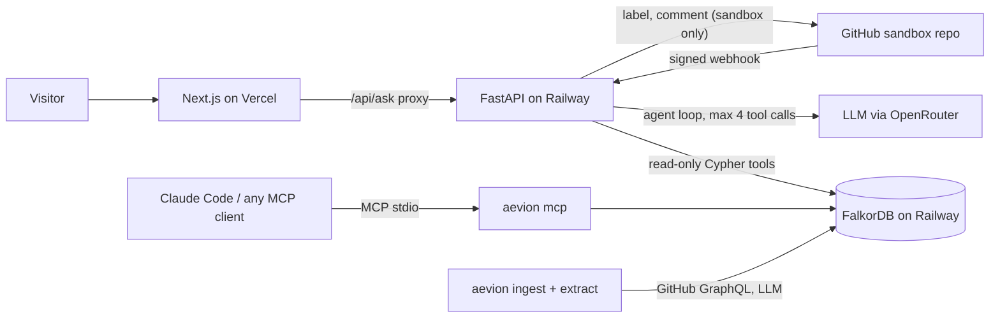
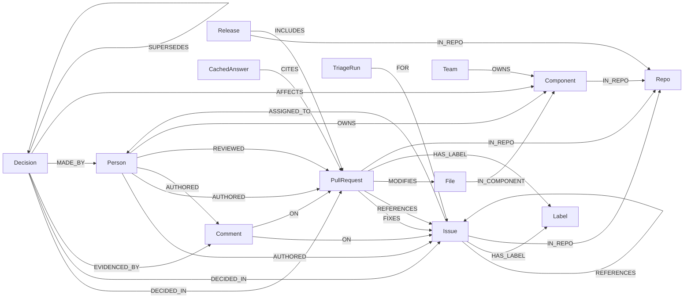

# Aevion: a company brain on FalkorDB

> Team **Aevion**'s entry for [Graph Hacks: Context for AI Agents](https://www.wemakedevs.org/hackathons/falkordb) (WeMakeDevs × FalkorDB, Oct 15–18, 2026).
> **Tracks:** 03 Company Brain (main) · 01 Agents That Act on Connected Data.

**Live app:** https://aevion-alpha.vercel.app · **API:** https://api-production-ae7a.up.railway.app/healthz · **Triage sandbox:** [hineshmiyani/aevion-sandbox](https://github.com/hineshmiyani/aevion-sandbox) · **Demo video:** _link added at submission_

Aevion loads a GitHub organisation's public history into a FalkorDB graph and answers the questions people ask a senior colleague: *who knows this code? why was this decided? what changed while I was away?* Every answer carries the **evidence path**: the nodes and edges in the graph that produced it, each one a real GitHub link.

The demo dataset is the [FalkorDB organisation](https://github.com/FalkorDB) itself: 9 repositories, the last 12 months.

| Ask | What the graph does |
|---|---|
| *Who knows the falkordb-py client code best?* | Component ← File ← PullRequest ← Person, scored by role and recency |
| *Why did FalkorDB gate main on a merge queue?* | Full-text search over Decisions extracted from PR threads, then the thread, the comments that show it, who made it and what it replaced |
| *What's been happening in GraphRAG-SDK's ingestion code lately?* | Recent merged PRs, open issues and the active people in that Component |
| *What else does FalkorDB/FalkorDB#3176 touch?* | Linked issues and PRs, the files and Components, other PRs changing the same files |
| *Catch me up on falkordb-browser since October 1.* | Merged PRs, the issues they closed, releases and who drove the work |

And it **acts**: file an issue on the [sandbox repo](https://github.com/hineshmiyani/aevion-sandbox) and within about 10 seconds Aevion labels it with the most likely area of the code, names the people who know that area, and replies with similar issues, all found in the FalkorDB graph.

## Why FalkorDB does the real work

Remove FalkorDB and nothing works: every answer is a traversal.

- **Multi-hop expertise.** "Who knows X" is a four-hop pattern (`Person → PullRequest → File → Component`), weighted per edge type and decayed by age, computed live at question time. There is no precomputed expertise table.
- **Answers by analogy.** A new issue has no edges yet, so triage walks from the issues that look like it to the PRs that fixed them, the files those PRs changed and their Components: `Issue ← FIXES – PullRequest – MODIFIES → File – IN_COMPONENT → Component`.
- **Full-text indexes** (`db.idx.fulltext`) find candidate Issues and Decisions; FalkorDB's stemmer matches "queues" to "queue".
- **Time in the graph.** CODEOWNERS ownership is time-ranged (`OWNS {valid_from, valid_to}`) and Decisions form `SUPERSEDES` chains, so "what did we believe before?" is a query.
- **Read-only by construction.** Every tool query runs with `GRAPH.RO_QUERY`.
- **One datastore.** Cached hero answers and triage runs are nodes too (`CachedAnswer -CITES->` evidence, `TriageRun -FOR-> Issue`).

The current graph: **20,961 nodes and 80,642 edges**, including 3,544 PRs, 2,326 issues, 8,607 comments and 534 Decisions.

## Architecture



- **Ingestion** (`aevion ingest`): GitHub GraphQL → normalised records → idempotent `UNWIND … MERGE` into one graph per org (`org:falkordb`).
- **Decision extraction** (`aevion extract`): an LLM proposes Decisions from discussed PR and issue threads; every person, Component and comment it names is checked against the thread before it reaches the graph.
- **Six fixed Cypher tools** (`experts_for`, `decision_trail`, `area_history`, `related_work`, `catch_up`, `triage_candidates`) are shared by the HTTP API, the agent and the MCP server.
- **The agent** picks tools, cites numbered sources as `[n]`, and returns the merged evidence path and the Cypher it ran.
- **Triage** runs as a dry run on any issue (`POST /api/triage`) and applies only on the sandbox repo ([ADR-0005](docs/adr/0005-triage-agent-writes-only-to-sandbox.md)). It never @-mentions anyone and never references FalkorDB's issues in what it posts ([ADR-0013](docs/adr/0013-triage-never-pings-real-people.md)).

Deployment details: [docs/architecture/deployment.md](docs/architecture/deployment.md).

## Graph data model

Full reference with every property: [docs/architecture/graph-model.md](docs/architecture/graph-model.md).



### Node labels

| Label | Key | Main properties |
|---|---|---|
| `Repo` | `full_name` | `name`, `url`, `stars`, `default_branch` |
| `Person` | `login` | `avatar_url`, `is_bot` |
| `Issue` | `key` (`FalkorDB/FalkorDB#123`) | `title`, `body_excerpt`, `state`, `created_at`, `closed_at`, `url` |
| `PullRequest` | `key` | `title`, `body_excerpt`, `state`, `created_at`, `merged_at`, `additions`, `deletions`, `url` |
| `Comment` | `id` (`ic:` / `rv:` / `rc:` + GitHub id) | `kind`, `excerpt`, `created_at`, `url` |
| `File` | `key` (`repo:path`) | `path`, `repo`, `is_doc` |
| `Component` | `key` (`repo:path prefix`) | `name`, `path_prefix`, `repo`, `source` |
| `Label` | `key` (`repo:name`) | `name`, `color` |
| `Release` | `key` (`repo@tag`) | `tag`, `published_at`, `url` |
| `Team` | `key` | `name` (CODEOWNERS teams) |
| `Decision` | `id` (content hash) | `summary`, `rationale`, `alternatives`, `decided_at`, `confidence`, `model` |
| `CachedAnswer` | `key` (question hash) | `question`, `response`, `model`, `created_at` |
| `TriageRun` | `issue_key` | `at`, `result` (sandbox graph only) |

Times are epoch milliseconds. A Component is a directory prefix (depth 2 by default, with per-repo overrides in [config/orgs/falkordb.toml](config/orgs/falkordb.toml)).

### Relationship types

| Type | From → To | Properties |
|---|---|---|
| `AUTHORED` | Person → Issue / PullRequest / Comment | `at` |
| `REVIEWED` | Person → PullRequest | `state`, `at` |
| `ON` | Comment → Issue / PullRequest | |
| `FIXES` | PullRequest → Issue | |
| `REFERENCES` | Issue / PullRequest → Issue / PullRequest | |
| `MODIFIES` | PullRequest → File | `additions`, `deletions` |
| `IN_COMPONENT` | File → Component | |
| `HAS_LABEL`, `ASSIGNED_TO`, `IN_REPO`, `INCLUDES` | as in the diagram | |
| `OWNS` | Person / Team → Component | `valid_from`, `valid_to`, `source` (time-ranged CODEOWNERS) |
| `DECIDED_IN`, `EVIDENCED_BY`, `MADE_BY`, `AFFECTS` | Decision → thread / Comment / Person / Component | |
| `SUPERSEDES` | Decision → Decision | `at` |
| `CITES` | CachedAnswer → any cited node | |
| `FOR` | TriageRun → Issue | |

**Indexes:** range indexes on every key, `PullRequest.merged_at`, and full-text indexes on `Issue(title, body_excerpt)` and `Decision(summary, rationale)`.

## Cypher queries

Every query the product runs, with why it's shaped that way: [docs/architecture/cypher-queries.md](docs/architecture/cypher-queries.md).

| Tool / feature | What the query does | Measured locally |
|---|---|---|
| `experts_for` | Component ← File ← merged PR ← Person (authored 3.0, reviewed 2.0, commented 0.5, × `exp(-age/260 days)`) | 88 ms |
| `decision_trail` | `db.idx.fulltext.queryNodes('Decision', …)`, re-ranked by keyword coverage, then each Decision's thread, fixed issues, quotes, people, Components and `SUPERSEDES` chain | 14 ms |
| `area_history` | Recent merged PRs, open issues and active people for a Component | 38 ms |
| `related_work` | `FIXES` / `REFERENCES` both ways, files and Components touched, overlapping PRs | 20 ms |
| `catch_up` | Merged PRs since a date, the issues they closed, releases | 11 ms |
| `triage_candidates` | Similar issues (full-text), Component votes through the PRs that fixed them, Experts | 75 ms |
| Cached answers | `MERGE (:CachedAnswer)` plus `CITES` edges to the cited nodes | 14 ms per hit |

The core of expertise, the query behind *"who knows X?"*:

```cypher
MATCH (c:Component)<-[:IN_COMPONENT]-(f:File)<-[:MODIFIES]-(pr:PullRequest)
WHERE c.key IN $components AND pr.merged_at IS NOT NULL
MATCH (p:Person)-[r:AUTHORED|REVIEWED]->(pr)
WHERE NOT p.is_bot
WITH p, pr, type(r) AS role, collect(f.key)[0] AS file, collect(c.key)[0] AS component,
     exp(-((timestamp() - pr.merged_at) / 86400000.0) / $decay) AS recency
RETURN p.login AS login, pr.key AS pr, pr.title AS title, pr.url AS url, pr.merged_at AS at,
       role, file, component,
       CASE role WHEN 'AUTHORED' THEN $authored ELSE $reviewed END * recency AS points
```

And triage's walk from similar issues to the code that fixed them (abridged). The `WITH` keeps FalkorDB's planner on the `Issue.key` index: as one pattern it scanned every File and timed out in production.

```cypher
UNWIND $issues AS issue_key
MATCH (i:Issue {key: issue_key})<-[:FIXES]-(pr:PullRequest)
WITH issue_key, pr
MATCH (pr)-[:MODIFIES]->(f:File)-[:IN_COMPONENT]->(c:Component)
WHERE NOT f.is_doc
RETURN issue_key AS issue, pr.key AS pr, f.key AS file, c.key AS component, c.name AS name
```

## Run it locally

**Prerequisites:** Docker, [uv](https://docs.astral.sh/uv/) 0.13+, Node 22 with Corepack (pnpm 12), and for a fresh graph a GitHub token (or `gh auth login`) and an [OpenRouter](https://openrouter.ai) key.

```bash
cp .env.example .env    # then fill in OPENROUTER_API_KEY (and GITHUB_TOKEN if you don't use gh)
```

```bash
docker compose -f infra/docker-compose.yml up -d
```

```bash
uv sync --project apps/api
```

```bash
corepack enable && pnpm --dir apps/web install
```

Build the graph (about 10 minutes for 9 repos; `--cache` reuses raw GitHub responses on later runs), extract Decisions (about $0.40 of LLM calls; `--dry-run` prices it first), and warm the hero answers:

```bash
uv run --project apps/api aevion ingest
```

```bash
uv run --project apps/api aevion extract
```

```bash
uv run --project apps/api aevion warm-cache
```

Start the API and the web app, then open http://localhost:3000:

```bash
uv run --project apps/api uvicorn aevion.api.main:app --port 8000
```

```bash
AEVION_API_URL=http://localhost:8000 pnpm --dir apps/web dev
```

Without `AEVION_API_URL` the web app serves a built-in sample answer, so the UI works with no backend. Every variable is listed in [.env.example](.env.example).

### Use the graph from Claude Code (MCP)

```bash
claude mcp add aevion -- uv run --project "$PWD/apps/api" aevion mcp --org FalkorDB
```

The six tools then appear in Claude Code with the same schemas the API uses.

### Tests

```bash
uv run --project apps/api pytest
```

```bash
pnpm --dir apps/web test:e2e
```

The API suite (157 tests) needs the local FalkorDB from Docker for its integration tests; models and GitHub are always mocked, and the sandbox writer refuses to reach the real GitHub under test. The Playwright smoke tests run the web app against its sample answer on desktop and mobile.

## Where things live

| You want to… | Go to |
|---|---|
| Read the product spec | [docs/product/SPEC.md](docs/product/SPEC.md) |
| Read decisions we've locked | [docs/adr/](docs/adr/) |
| See the graph model and every query | [docs/architecture/](docs/architecture/) |
| See how it's deployed | [docs/architecture/deployment.md](docs/architecture/deployment.md) |
| Test the app by hand | [docs/process/manual-testing.md](docs/process/manual-testing.md) |
| Learn our domain vocabulary | [GLOSSARY.md](GLOSSARY.md) |
| See the build plan | [tasks/plan.md](tasks/plan.md) |
| Learn our branch and commit conventions | [CONTRIBUTING.md](CONTRIBUTING.md) |
| See how we used AI assistants (Rule 11) | [docs/process/ai-usage-disclosure.md](docs/process/ai-usage-disclosure.md) |
| See the full docs map | [docs/README.md](docs/README.md) |

## Data and safety

- Only public data: the FalkorDB organisation's public repositories ([ADR-0004](docs/adr/0004-product-scope-and-data.md)).
- Aevion writes to GitHub only on [hineshmiyani/aevion-sandbox](https://github.com/hineshmiyani/aevion-sandbox), with a token GitHub limits to that repo. The sandbox's issues are labelled copies of public FalkorDB issues.
- The public app has no logins, so asks are rate-limited per visitor (10 a minute, 100 a day) and the LLM spend has a hard budget.

## Team

| Name | GitHub |
|---|---|
| Hinesh Miyani (lead) | [@hineshmiyani](https://github.com/hineshmiyani) |
| Jignesh Dabhi | [@zephyr2e1](https://github.com/zephyr2e1) |
| Jaydeep Prajapati | [@jaydeepprajapati123](https://github.com/jaydeepprajapati123) |
| Het Thummar | [@hetthummar](https://github.com/hetthummar) |
