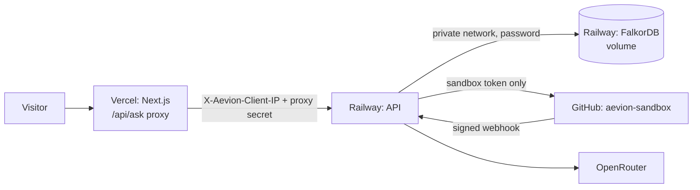

# Deployment

Production follows [ADR-0012](../adr/0012-deployment-and-sandbox.md): FalkorDB and the API on Railway, the web app on Vercel.

| Piece | Where | URL |
|---|---|---|
| Web app (Next.js) | Vercel project `aevion` (Hobby) | https://aevion-alpha.vercel.app |
| API (FastAPI) | Railway project `aevion`, service `api` | https://api-production-ae7a.up.railway.app |
| FalkorDB `v4.22.1` | Railway service `falkordb`, volume at `/var/lib/falkordb/data` | private only: `falkordb.railway.internal:6379` |
| Triage webhook | `hineshmiyani/aevion-sandbox` → `POST /webhooks/github` | events: Issues, Issue comments |



## Configuration

Secrets live in the services' environment, set from the local `.env` through stdin so they never appear in a command line or log.

| Service | Variable | Notes |
|---|---|---|
| `falkordb` | `REDIS_ARGS` | `--requirepass <password> --save 60 1`: password, plus a snapshot to the volume within a minute of any change |
| `api` | `FALKORDB_URL` | `redis://default:<password>@falkordb.railway.internal:6379` |
| `api` | `OPENROUTER_API_KEY`, `LLM_BUDGET_USD=8`, `LLM_DATA_DIR=/data/llm` | The spend ledger is on the `api` volume, so the budget guard survives redeploys. Production's $8 plus local spend stays inside the OpenRouter credit |
| `api` | `SANDBOX_GITHUB_TOKEN`, `GITHUB_WEBHOOK_SECRET` | Triage writes, webhook verification |
| `api` | `PROXY_SECRET`, `CORS_ORIGINS` | Trust the proxy's visitor IP; allow only the two Vercel domains |
| `api` | `RAILWAY_DOCKERFILE_PATH=apps/api/Dockerfile` | Built from the repo root; `.railwayignore` keeps the upload small |
| web | `AEVION_API_URL`, `AEVION_PROXY_SECRET`, `ENABLE_EXPERIMENTAL_COREPACK=1` | Corepack makes Vercel build with the pinned `pnpm@12.14.0` |

## Deploying

- **Web:** the Vercel project is connected to the GitHub repo. A push to `main` deploys production; every PR gets a preview build, which shows as the `Vercel` check. Project settings: root directory `apps/web`, install `npx --yes pnpm@12.14.0 install --frozen-lockfile`, build `npx --yes pnpm@12.14.0 run build`, Node 24.x.
- **API:** deployed from the CLI:

```bash
railway up --service api --detach
```

Why the pinned commands: git builds start at the repo root, which has no `package.json`, so Vercel's Corepack detection never sees `"packageManager": "pnpm@12.14.0"` in `apps/web` and falls back to an old pnpm that can't read pnpm 12's lockfile (`ERR_INVALID_THIS`). The first CLI deploys worked only because they uploaded `apps/web` as the root.

## Loading the graph

Production's graphs are a byte-for-byte copy of the local ones, not a second ingestion: both run FalkorDB `v4.22.1`, so Redis `DUMP`/`RESTORE` moves each graph key whole (nodes, edges, indexes, Decisions, cached answers) in about 9 seconds. The path in is a temporary TCP proxy, deleted straight after:

1. `railway tcp-proxy create --service falkordb --port 6379`
2. For `org:falkordb` and `org:aevion-sandbox`: `DUMP` locally, `RESTORE … REPLACE` remotely (password from `.env`), then `BGSAVE`.
3. Compare node and edge counts on both sides (20,961 nodes, 80,642 edges at first load).
4. `railway tcp-proxy delete <id> --service falkordb --yes`, and check the port refuses connections.

After a re-ingest or `aevion warm-cache --refresh`, repeat the copy.

## Checks after a deploy

- `GET /healthz` lists both graphs.
- A hero question on the web app returns `cached: true`; a new question answers live.
- `POST /api/triage` dry run on a FalkorDB issue returns a Component and an Expert.
- The sandbox webhook's latest delivery is `202`; filing a sandbox issue gets a label and a comment (10.7 s on first deploy).

## Lessons from the first deploy

- **Plans that look fine locally can time out in production.** FalkorDB's default query `TIMEOUT` is 1 s. The triage query that found fixing PRs took 0.8 s locally because FalkorDB planned it from a scan of every File; on Railway it timed out. Splitting the pattern with `WITH` made it start from the `Issue.key` index (5 ms). See the note in [cypher-queries.md](cypher-queries.md).
- Vercel's git integration, switched on by `vercel link`, built the release PR from the repo root and failed twice: no Next.js at the root, then the wrong pnpm. Fixed with the root directory and pinned commands above.
- The Railway CLI's `volume add -s <service>` crashed; linking the service first (`railway service link <name>`) and then `railway volume add` worked.
