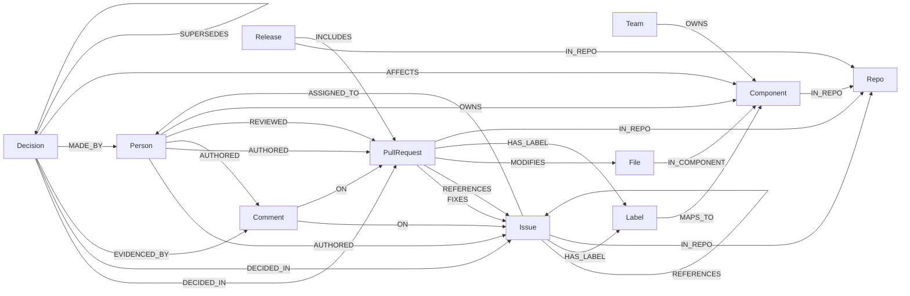

# Graph data model

**Status:** v1 design, 2026-10-17 ([ADR-0011](../adr/0011-graph-data-model.md)). Keep this file in sync with the ingestion code; the README's graph-model section is generated from it.

## Graphs

FalkorDB holds **one graph per org** (multigraph). Names come from `graph_name_for(org)` and are **always lowercase**, because GitHub logins are case-insensitive and `FalkorDB` / `falkordb` must never become two graphs (decided in AEV-17):

| Graph | Contents |
|---|---|
| `org:falkordb` | The 9 demo repos, last 12 months ([ADR-0004](../adr/0004-product-scope-and-data.md)) |
| `org:aevion-sandbox` | `hineshmiyani/aevion-sandbox`, for the live triage demo |

## Diagram



## Node labels

All times are **epoch milliseconds** (integers). `key` is the MERGE key and is unique within a graph.

| Label | Key | Properties | Source |
|---|---|---|---|
| `Repo` | `full_name` (`FalkorDB/FalkorDB`) | `name`, `url`, `stars`, `default_branch` | GitHub API |
| `Person` | `login` | `name`, `avatar_url`, `is_bot` | GitHub API |
| `Issue` | `key` (`FalkorDB/FalkorDB#123`) | `number`, `title`, `body_excerpt`, `state`, `created_at`, `closed_at`, `updated_at`, `url`, `ref_keys` | GitHub API |
| `PullRequest` | `key` (`FalkorDB/FalkorDB#456`) | `number`, `title`, `body_excerpt`, `state`, `created_at`, `merged_at`, `closed_at`, `updated_at`, `url`, `additions`, `deletions`, `ref_keys`, `fix_keys` | GitHub API |
| `Comment` | `id` (`ic:` / `rv:` / `rc:` + GitHub ID, since each comment type has its own ID space) | `kind` (`issue` / `review` / `review_thread`), `excerpt`, `created_at`, `url` | GitHub API; comments by bots are skipped |
| `File` | `key` (`FalkorDB/FalkorDB:src/x.c`) | `path`, `repo`, `is_doc` | PR file lists |
| `Component` | `key` (`FalkorDB/FalkorDB:src/execution_plan`) | `name`, `repo`, `path_prefix`, `source` (`path` / `label` / `codeowners`) | Derived: directory prefix, depth 2 by default, with per-prefix overrides in `config/orgs/*.toml` (`component_depth_overrides`, longest prefix wins). Rebuild links after changing depth with `aevion ingest --reset-components` |
| `Label` | `key` (`FalkorDB/FalkorDB:bug`) | `name`, `color`, `repo` | GitHub API |
| `Release` | `key` (`FalkorDB/FalkorDB@v4.8.0`) | `tag`, `name`, `published_at`, `url`, `pr_keys` | GitHub API (last 12 months) |
| `Team` | `key` (`FalkorDB/falkordb-core`) | `name` | CODEOWNERS team owners (membership isn't public, so teams aren't expanded to people) |
| `Decision` | `id` (content hash) | `summary`, `rationale`, `alternatives`, `decided_at`, `confidence`, `model`, `source_url` | LLM extraction ([ADR-0010](../adr/0010-llm-model-bake-off.md)) |

## Relationship types

| Type | From → To | Properties | Notes |
|---|---|---|---|
| `AUTHORED` | Person → Issue / PullRequest / Comment | `at` | No REVIEWED edge for self-reviews |
| `REVIEWED` | Person → PullRequest | `state` (`APPROVED` / `CHANGES_REQUESTED` / `COMMENTED`), `at` | |
| `ON` | Comment → Issue / PullRequest | | |
| `FIXES` | PullRequest → Issue | | From closing keywords and GitHub's `closingIssuesReferences`; created by `link_references()` from `fix_keys` |
| `REFERENCES` | Issue / PullRequest → Issue / PullRequest | | From `#123`, `owner/repo#123` and GitHub URLs in titles, bodies and human comments (code spans ignored); created by `link_references()` from `ref_keys` after all repos load, so cross-repo links resolve |
| `MODIFIES` | PullRequest → File | `additions`, `deletions` | |
| `IN_COMPONENT` | File → Component | | |
| `MAPS_TO` | Label → Component | | Per-repo config |
| `HAS_LABEL` | Issue / PullRequest → Label | | |
| `ASSIGNED_TO` | Issue → Person | | |
| `IN_REPO` | Component / Issue / PullRequest / Release → Repo | | |
| `OWNS` | Person / Team → Component | `source` (`CODEOWNERS`), **`valid_from`, `valid_to`** | Time-ranged from CODEOWNERS history; `valid_to = null` means current; `valid_from = 0` if the first version's date is unknown. Only directory patterns map to Components |
| `INCLUDES` | Release → PullRequest | | From `#n` / PR URLs in release notes; created by `link_references()` from `pr_keys` |
| `DECIDED_IN` | Decision → PullRequest / Issue | | |
| `EVIDENCED_BY` | Decision → Comment | | The comments the extraction cited |
| `MADE_BY` | Decision → Person | | |
| `AFFECTS` | Decision → Component | | |
| `SUPERSEDES` | Decision → Decision | `at` | Time chain for "what did we believe before?" |

## Graph lifecycle

FalkorDB's read-only command (`GRAPH.RO_QUERY`) **fails on a graph that doesn't exist yet** ("Invalid graph operation on empty key"); only `GRAPH.QUERY` creates one. So every org graph is created by `bootstrap()` (`OrgGraph.ensure_exists()` plus indexes) before any tool reads from it, and a read on a missing graph raises `GraphNotFoundError`. Found and tested in AEV-17.

## Indexes

```cypher
CREATE INDEX FOR (r:Repo) ON (r.full_name)
CREATE INDEX FOR (p:Person) ON (p.login)
CREATE INDEX FOR (l:Label) ON (l.key)
CREATE INDEX FOR (t:Team) ON (t.key)
CREATE INDEX FOR (rel:Release) ON (rel.key)
CREATE INDEX FOR (i:Issue) ON (i.key)
CREATE INDEX FOR (pr:PullRequest) ON (pr.key)
CREATE INDEX FOR (c:Comment) ON (c.id)
CREATE INDEX FOR (f:File) ON (f.key)
CREATE INDEX FOR (c:Component) ON (c.key)
CREATE INDEX FOR (d:Decision) ON (d.id)
CREATE INDEX FOR (pr:PullRequest) ON (pr.merged_at)
CALL db.idx.fulltext.createNodeIndex('Issue', 'title', 'body_excerpt')
CALL db.idx.fulltext.createNodeIndex('Decision', 'summary', 'rationale')
```

## Expertise query (sketch)

"Who knows component X?" is answered live ([ADR-0011](../adr/0011-graph-data-model.md) §3). The weights are design constants: merged PR authored 3, review 2, comment 0.5, with exponential recency decay (half-life ~180 days). The **evidence** is the list of PRs behind each score.

**Verified on FalkorDB v4.22.1** (AEV-17, `tests/integration/test_falkordb_features.py`): `timestamp()`, `exp()`, `CASE type(r)`, list slicing and the full query below run as written.

```cypher
MATCH (c:Component {key: $component})<-[:IN_COMPONENT]-(:File)<-[:MODIFIES]-(pr:PullRequest)
WHERE pr.merged_at IS NOT NULL
MATCH (p:Person)-[r:AUTHORED|REVIEWED]->(pr)
WHERE NOT p.is_bot
WITH p, pr,
     CASE type(r) WHEN 'AUTHORED' THEN 3.0 ELSE 2.0 END AS weight,
     (timestamp() - pr.merged_at) / 86400000.0 AS age_days
WITH p, sum(weight * exp(-age_days / 260.0)) AS score, collect(DISTINCT pr.url)[..5] AS evidence
RETURN p.login AS person, round(score * 10) / 10 AS score, evidence
ORDER BY score DESC
LIMIT 5
```

The full query reference for all six tools lives in [cypher-queries.md](cypher-queries.md), written during implementation.

## Decision-candidate filter

A thread goes to the extraction model only if it matches at least one of:

- a merged PR with ≥ 3 review comments, **or** a linked issue;
- a closed issue with ≥ 3 comments;
- a PR that modifies a docs file (`is_doc = true`).

Everything else stays deterministic structure with no LLM cost. On the full demo graph this selects **1,177 threads**, projected at **$0.23** with Haiku 5.5 (`aevion extract --dry-run`).

**Validation before anything reaches the graph:** `MADE_BY` only for people who took part in the thread, `AFFECTS` only for Components the thread's PRs touched, `EVIDENCED_BY` only for real comments of the thread, and decisions with confidence below 0.5 are dropped. A Decision's id is a hash of the thread key and summary, so re-runs MERGE onto the same node.
